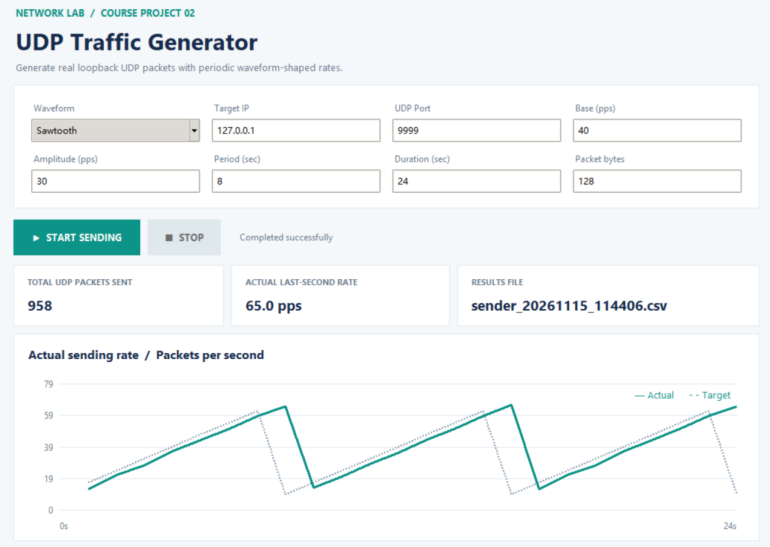
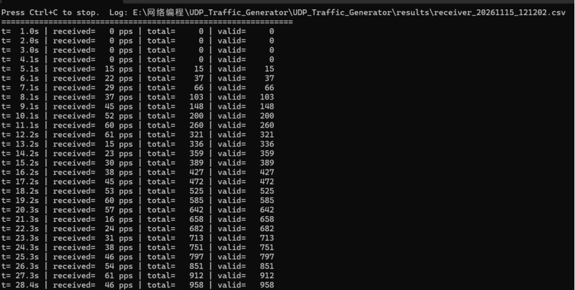
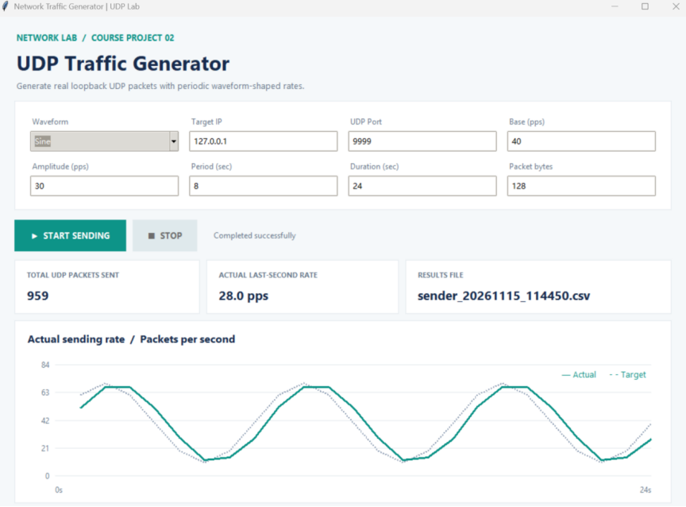
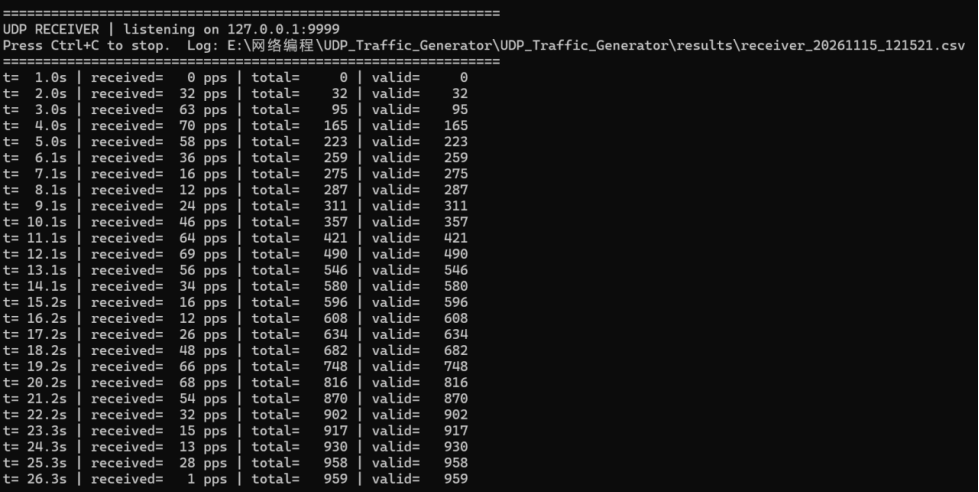

# UDP Traffic Generator · UDP 网络流量发生器

基于 **Python + UDP Socket + Tkinter** 开发的网络编程项目。程序能够按照指定的周期性波形控制 UDP 报文发送速率，并通过独立接收端验证实际报文收发情况。

项目面向 **Windows 10/11**，主要使用 Python 标准库，无需额外安装第三方 Python 包。

## ✨ 项目功能

- **两种流量模式**：锯齿波（Sawtooth）与正弦波（Sine）。
- **真实 UDP 发包**：通过 `socket` 向本机 `127.0.0.1:9999` 发送 UDP 数据报，而不是仅绘制模拟曲线。
- **可视化界面**：使用 Tkinter 配置参数、开始/停止发送，并显示实际速率与目标速率曲线。
- **接收端验证**：实时统计每秒接收报文数、累计报文数和有效报文数。
- **实验数据导出**：发送端与接收端将统计结果保存为 CSV 文件。
- **自动化测试**：提供波形计算和本机 UDP 收发的基础测试。

## 📁 项目结构

```text
UDP-Traffic-Generator/
├── sender_gui.py               # 图形化 UDP 发送端
├── receiver.py                 # UDP 接收端
├── traffic_core.py             # 流量波形与发送速率相关逻辑
├── run_sender.bat              # Windows 发送端启动脚本
├── run_receiver.bat            # Windows 接收端启动脚本
├── run_tests.bat               # Windows 测试启动脚本
├── tests/                      # 单元测试
├── results/                    # 运行时生成的 CSV 数据（如已保留）
├── README.md                   # 项目介绍与使用说明
└── README_运行和截图指南.md     # 原项目详细操作指南（如已保留）
```

`.bat` 是 **Windows 批处理启动脚本**，用于调用对应的 `.py` 文件。实际程序逻辑主要位于三个 `.py` 文件和 `tests/` 目录中。

## 🛠️ 运行环境

- 操作系统：Windows 10 / 11
- Python：Python 3（建议安装较新的稳定版本）
- 图形界面：Tkinter（通常随 Windows 版 Python 一同安装）
- 其他依赖：Python 标准库，包括 `socket`、`threading`、`csv`、`time`、`math` 等

## ⚙️ 实验参数

| 参数 | 默认值 | 含义 |
| --- | --- | --- |
| Waveform | `Sawtooth` / `Sine` | 流量波形 |
| Target IP | `127.0.0.1` | UDP 目标地址（本机回环） |
| UDP Port | `9999` | UDP 接收端监听端口 |
| Base (pps) | `40` | 基础发送速率 |
| Amplitude (pps) | `30` | 速率变化幅度 |
| Period (sec) | `8` | 单个波形周期 |
| Duration (sec) | `24` | 每次实验持续时间 |
| Packet bytes | `128` | 每个 UDP 数据报的有效载荷大小 |

`pps` 表示 **packets per second（每秒数据包数）**。默认实验包含约三个完整波形周期。

## 📈 流量生成原理

令基础速率为 `B`、振幅为 `A`、周期为 `T`、经过时间为 `t`，目标发送速率为 `R(t)`：

**锯齿波（Sawtooth）**

$$
R(t) = \max\left(0,\ B-A+2A\frac{t\bmod T}{T}\right)
$$

目标速率在一个周期内逐渐上升，到周期边界时回落，随后重复。

**正弦波（Sine）**

$$
R(t) = \max\left(0,\ B+A\sin\left(\frac{2\pi t}{T}\right)\right)
$$

目标速率围绕基础速率周期性平滑变化。

发送端根据目标速率和经过的时间累计发包额度，并使用 UDP Socket 发送真实数据报。受操作系统调度和计时精度影响，**实际每秒速率可能与理论曲线存在少量差异**。

## 📊 实验结果示例

以下数据来自一次 **Windows 本机回环实验**（参数为 Base = 40 pps、Amplitude = 30 pps、Period = 8 s、Duration = 24 s、Packet bytes = 128 B）：

| 实验模式 | 发送报文数 | 接收报文数 | 有效报文数 | 观察到的丢包数 |
| --- | ---: | ---: | ---: | ---: |
| 锯齿波 Sawtooth | 958 | 958 | 958 | 0 |
| 正弦波 Sine | 959 | 959 | 959 | 0 |

- **锯齿波**：实际流量呈周期性上升和快速回落的趋势。
- **正弦波**：实际流量呈平滑的周期性变化。
- 在上述 **本机回环测试** 中，接收总数与发送总数相同，未观察到丢包。

> 以上为特定实验环境下的一次实测结果，并不意味着 UDP 协议能够保证可靠送达，也不保证其他电脑上的报文数完全相同。

## 🖼️ 运行截图

### 1. 锯齿波（Sawtooth）实验

**发送端运行截图**



**接收端运行截图**



### 2. 正弦波（Sine）实验

**发送端运行截图**



**接收端运行截图**



<!--
### 锯齿波实验


### 正弦波实验


-->

## 📄 CSV 实验数据

运行后会在项目的 `results/` 目录中保存以时间戳命名的 CSV 文件，例如：

```text
sender_20261115_114406.csv
receiver_20261115_121202.csv
```

发送端 CSV 用于保存流量发送统计，接收端 CSV 用于保存接收统计。可使用 Excel 等工具查看并进一步分析。

## ❓ 常见问题

**1. 点击启动后，接收端一直显示 `received = 0`？**

请先确认已经启动 `run_receiver.bat`，并检查发送端目标地址是否为 `127.0.0.1`、端口是否为 `9999`。接收端启动后的前几秒没有数据是正常现象，前提是发送端尚未开始发送。

**2. 双击 `.bat` 没有反应或窗口闪退？**

先在 CMD 中运行 `python --version` 检查环境，再进入项目目录运行 `python sender_gui.py` 或 `python receiver.py` 查看具体报错信息。

**3. 为什么实际总报文数不一定正好是 960？**

默认基础速率为 40 pps，持续 24 秒，对应理论估算约 960 个报文。实际发送采用按时间累计额度的近似调度方式，可能受到计时精度、线程调度以及实验结束边界等因素影响。

**4. 是否支持余弦波？**

当前版本提供 `Sawtooth` 和 `Sine` 两种可选模式。余弦波与正弦波相差一个相位，但**本版本未单独提供 `Cosine` 选择项**，可作为后续扩展功能。

## 🔧 后续改进方向

- 增加单独的余弦波模式
- 加入发送端和接收端速率对比图
- 计算实际速率与理论目标速率的误差
- 增强 CSV 数据分析与可视化能力
- 在授权、受控的局域网环境中进行多机实验

## 📚 项目说明

本项目为**网络编程课程结课作业**，用于学习 UDP Socket 通信、周期性发包调度、图形界面设计以及网络收发数据统计。

请在本人拥有或明确授权的测试环境中运行。
